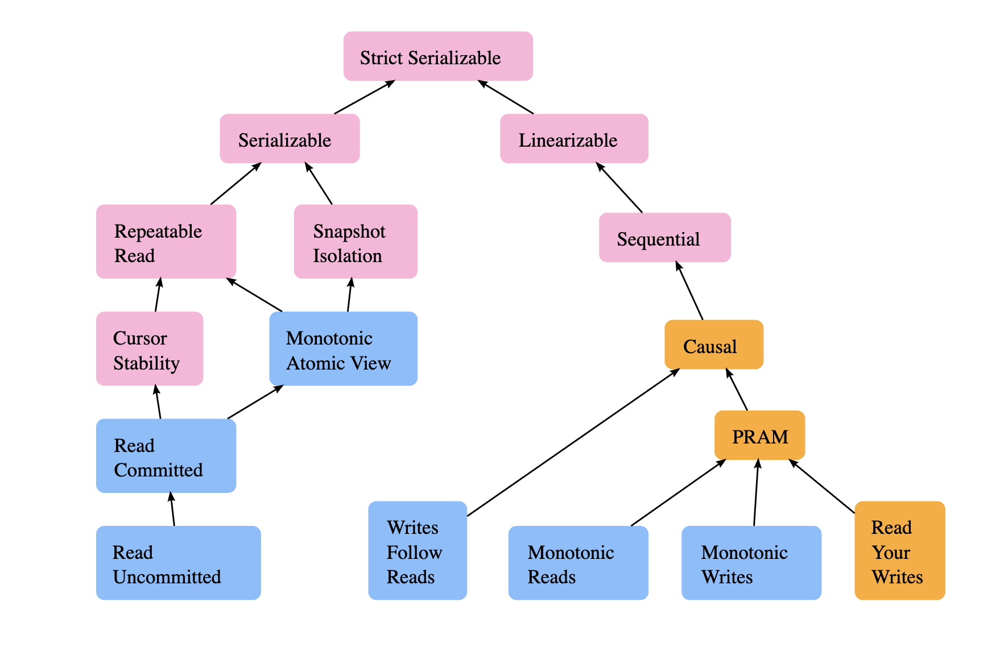

# Chapter 10 Consistency and Consensus

We have two competing philosophies of how we obtain consistency in distributed systems.

(1) Eventual Consistency

The fact that a system is replicated is made visible to the application, and application developers are expected to deal with the inconsistencies and conflicts that may arise.

(2) Strong consistency (aka linearisability)

Applications should not have to worry about internal details of replication and the system should behave as if it were a single node. Expectedly, this has a performance cost. Also, some kinds of faults that an EC system can tolerate cause a SC system to go down. 

This chapter delves deeply into the strongly consistent approach, focusing on 3 areas:

- Precisely define linearisability.
- Look at the problem of generating IDs and timestamps.
- Explore how Distributed Systems can achieve linearisability while still remaining fault-tolerant. The answer to this is *consensus algorithms*.

## Linearisability

The idea behind linearisability is this: if you want a replicated database to behave as simply as possible, you should make it behave as if it were a consistent single node database. In other words, make a system appear as if there is only 1 copy of the data. 

The key abstraction behind Transactions are allowing the application developer to be able to assume that, depending on their Tx level, certian race conditions won't occur, they won't have partially written state, and they won't have to contend with various other oddities that non-transactional application code interacting with the database could potentially face. 

The key abstraction behind stronger forms of consistency are that you can assume that a database is a consistent single-node database, even though it is replicated. Remember that replciation is introduced in scaling systems in the first place because it helps for fault tolerance and also allows for faster I/O, with faster reads if you're using single-leader replication (more nodes to read from), and faster reads and writes if you're using leaderless or multi-leader replication (since application can now read and write from >1 nodes).

Linearisability is also known as atomic consistency, strong consistency, immediate consistency, or external consistency. 

The basic idea of linearisability though is to make a system appear as if there is only one copy of the data, and all operations are atomic.

403: 'In a linearisable system, as soon as one client successfully complete a write, all clients reading from the db must be able to see the value just written'. In other words, it's a recency guarantee.

405: 'If reads that are concurrent with a write can return either the old or the new value, then readers could see a value flip back and forth between the old and the new value several times while a write is going on'. That is not linearisability. The values can't k

406: You can also only ever move forward in time with linearisabilit.

There are various weaker levels of consistency models than linearisability. 

#### What makes a System linearisable?

                                        

Lineralisability vs serialisability: Both seem to mean that things can be arranged in a sequential order. But importantly, Txs concern reading and writing multiple objects

Linearisability is a guarantee on reads and writes of a register (an individual object)

### Relying on Linearisability

Areas that it's important

##### Locking and Leader Election

##### Constraints and Uniqueness guarantees

## Implementing Linearisability

To recap: Linearisability concerns single operations on single objects. It's a guarantee about the order of things across distributed systems. 

Serialisability concerns > 1 operations on database Transactions. (It would also apply to 1 operation too, but this would be trivial and not really worth mentioning.) It guarantees that for N number of Transactions running concurrently on N number of rows, the database will handle it (ignoring implementation details) as if those Transactions were run one after the other. There is no guarantee in serialisability alone that your Transactions would run in any particular order, or that the first Transaction would go first, etc. 

So: Serialisability does not make guarantees about ordering, or about how your application will read the writes. Linearisability doesn't make any guarantees about how your Transactions will be run, or that Transactions won't interleave.

- Also, I think importantly, when we consider Serialisability and how we define and understand it, it's on one node. You can do Distributed Txs, but that's not what we really think about when we discuss them. It's fundamentally a phenomenon that we discuss and read about on 1 node.
- Linearisability, on the other hand, is purely a problem that only occurrs over > 1 node. It is trivial to assert that if you only have 1 node that your database runs on, to hold that things written in some order x1,x2,x3 must be read in that order by the application.

The two have an interesting history regarding their overlaps too. 

- There are many different variations of consistency that are weaker than linearisable. This is just the strongest form, and Klepmann deliberately chooses to focus only on this.

### Some Brief History and Setting the Scene

- As with most things in field of Distributed Systems, begins with Leslie Lamport
- Term is first coined in Herlehy and Wing in 1987, but built on in 1990 which becomes the standard citation source.

- Brewer's mentionin of the CAP theorem in a 2000 talk. Later formalised.

Obviously the simplest way to guarantee linearisability would be just to have a single copy of the data, and all operations on it are atomic. But this would render useless all of the benefits that we would want around replication. Namely:

- Resiliency under failure of nodes
- Scalability (single-leader for reads, multi-leader and leaderless for reads and writes)

Klepmann walks through each type of replication to assess if can be made linearisable:

#### Single-leader

- As long as you perform all writes on the leader, it's likely to be linearisable. *But* this assumes that you know who the leader is. Quite possible for a node that's not the leader to think that it is, and this would likely violate linearisability. 

- Sharding a single-leader db would not affect linearisability. But cross-shard Txs are a different matter.

#### Multi-leader 

- Multi-leader is *not linearisable*, because they concurrently process writes on multiple nodes and asyncrhonously replicate them to other nodes. So, they can produce writes which require resolution.

#### Leaderless 

- *Probably* not linearisable.

- Leaderless replication. Some claim it is, but doesn't seem to be true. Even with quorums, nonlinearisable behaviour is possible due to things like network delays. It may be the case, unavoidably, that a write that was submitted by the client earlier in time isn't processed properly until after another write submitted later. 

### Consensus algorithms

- Consensus algorithms are a service that the above can use in order to achieve consensus amongst the nodes as to determining things like who the leader is, who is in the cluster, or who holds a lock, etc. 
- But they also use replication themselves, and are therefore can be looked at from this angle.

Likely linearisable. Some consensus algorithms are essentially single-leader replication with automatic leader election and failover. Carefully designed to prevent split-brain, allowing them to implement linearisable storage safely. 

## The Cost of Linearisability

- Network partitions: The network within each region is working, but the regions can't talk to each other.
- For single-leader, this will fall over unless the leader is in the same region as all the replicas. 
- For multi-leader, each region can continue operating normally, assuming that the leaders are split across regions. 

- But more broadly, this failure issue doesn't need specifically a network partition - it will have the same symptoms if you have any sort of network failure. 

Here is the trade-off:

- If you require linearisability, and some replicas get disconnected for network reasons, the replicas will be temporarily unable to process requests. Sometimes know as 'CP' or 'Consistency under network partition'.
- If you *don't* require linearisability, you can process requests independently, even if disconnected. In this case, the application can remain available under network issues, but its behaviour is not linearisable. Known as AP, 'availability under partition'.

Klepmann is critical of CAP (as formally defined?) because:
- Considers only 1 consistency model (linearisability)
- Considers only 1 kind of fault (network partitions, which are quite rare)

There have been efforts to generalise CAP.

#### Linearisability and Network Delays

- Very few systems are linearisable in practice.
- Often this is done for performance reasons, not for fault tolerance. 
- This seems like a hard limit, not just an optimisation problem. E.g. Attiya and Welch prove that if you want linearisability, the response time of read and write requests is at least proportional to the uncertainty of delays in the network. 

## Id generators and logical clocks

